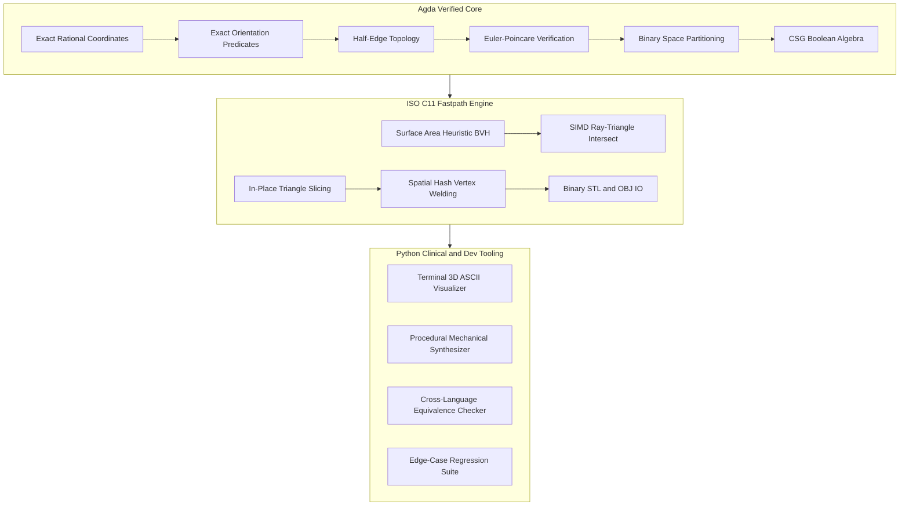

# Facet Architecture Specification

## Overview

Facet is a verified 3D constructive solid geometry (CSG) and boundary-representation (B-Rep) modeling engine. It pairs a formally verified mathematical core in Agda with a high-throughput ISO C11 fastpath engine and Python visualization tooling.

## Topological Invariants

Facet enforces the following constructive properties:
1. Every directed half-edge has a unique inverse twin.
2. Every face cycle is strictly closed.
3. The boundary operator is nilpotent: the boundary of a boundary is empty.
4. Euler-Poincare characteristic preservation: V - E + F = 2 for closed genus-0 2-manifolds.
